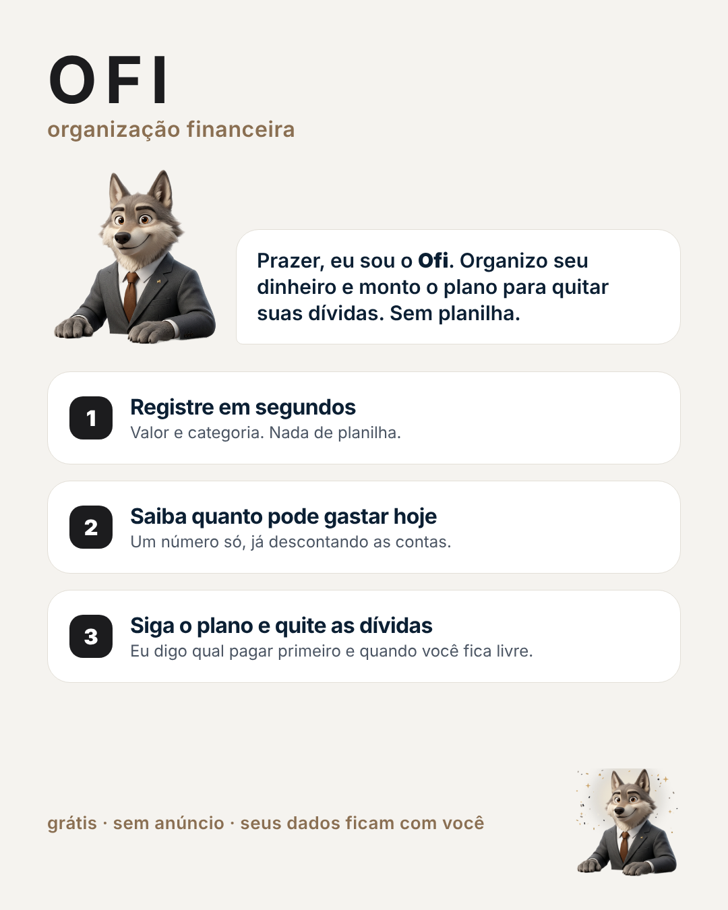

# OFI — Organização Financeira

Organização financeira simples e sóbria, para quem não quer planilha. Grátis, sem anúncio, e os dados ficam com você.



## O que tem
- **Um número só na tela inicial:** quanto você pode gastar hoje.
- **Botão +:** valor no teclado e a categoria. Poucos segundos.
- **Dívidas:** você arrasta o controle e vê na hora quando fica livre e quanto economiza de juros.
- **Ofi**, o lobo de terno, guia o primeiro acesso e comemora quando você quita uma dívida.
- Contas fixas automáticas, importação de extrato (OFX/CSV), limites por categoria.
- Funciona offline e dá pra **instalar no celular** como app.

## Publicar (5 min, grátis)
1. Crie um repositório público `ofi` no GitHub e suba esta pasta.
2. **Settings → Pages → Deploy from a branch → main / (root)**.
3. Pronto: `https://SEU_USUARIO.github.io/ofi/`. É só mandar esse link pra quem quiser usar.

## Instalar no celular
- **Android:** abra o link no Chrome → menu ⋮ → **Instalar app**
- **iPhone:** abra no Safari → Compartilhar → **Adicionar à Tela de Início**

## Nuvem (opcional, pra usar no PC e no celular juntos)
Dentro do app: **Mais → Nuvem**. Os dados ficam num repositório **privado** seu no GitHub. O passo a passo aparece lá.
Sem a nuvem, os dados ficam só no aparelho. Use **Mais → Backup** de vez em quando.

## Banco automático (opcional, grátis)
Um robô do GitHub Actions busca os lançamentos das suas contas pelo Open Finance (Meu Pluggy) duas vezes por dia e grava num repositório **privado** `ofi-dados`. O app lê esse arquivo pela **Nuvem**, categoriza e evita duplicar o que você já lançou.
O robô e a configuração ficam no repositório privado (`robo/` e `.github/workflows/sync-bancos.yml`), com as credenciais em *Secrets*. O token do app precisa de acesso **Contents: leitura e escrita** só a esse repositório.

## Personalizar
- **Nome do app:** `APP_NAME` em `js/app.js` + `manifest.json` + `<title>`.
- **Mascote:** imagens em `img/ofi-*.png` (humores: feliz, calmo, preocupado, festa); código em `js/mascote.js`.
- **Imagem de link (WhatsApp etc.):** troque `icons/og.png` por um caminho completo (`https://SEU_USUARIO.github.io/ofi/icons/og.png`) no `index.html`.

## Desenvolvimento
Sem build: HTML + CSS + JS puro.
```bash
python3 -m http.server 8000         # http://localhost:8000
node --test tests/*.test.js         # testes da lógica
```
